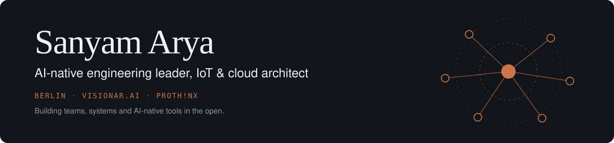
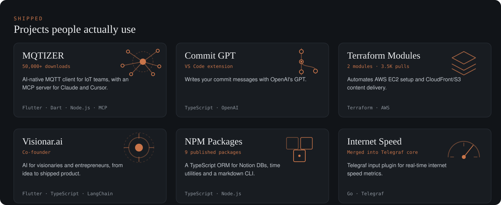
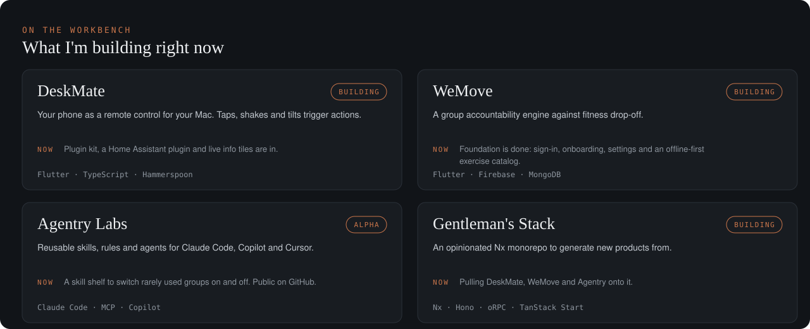

  

  
  
  
  

---

### What I'm up to

- Co-founder at [Visionar.ai](https://www.visionar.ai/), where we help teams become AI-native, and say so when AI is not the answer.
- Cloud Architect at [PROTH!NX](https://prothinx.io/), Berlin.
- Restructuring codebases so Claude and Copilot can navigate them as well as I can. I write about it on [my site](https://sanyamarya.com/).
- Learning German.

---

  

  <a href="https://mqtizer.com">MQTIZER</a> ·
  <a href="https://marketplace.visualstudio.com/items?itemName=ersanyamarya.commit-gpt">Commit GPT</a> ·
  <a href="https://registry.terraform.io/namespaces/ersanyamarya">Terraform Modules</a> ·
  <a href="https://www.visionar.ai/">Visionar.ai</a> ·
  <a href="https://www.npmjs.com/~ersanyamarya">NPM Packages</a> ·
  <a href="https://github.com/influxdata/telegraf/blob/release-1.33/plugins/inputs/internet_speed/README.md">Internet Speed</a>

  

  <a href="https://github.com/ersanyamarya/agentry-labs">Agentry Labs on GitHub</a> · more on the <a href="https://sanyamarya.com/scratchpad">scratchpad</a>

---

### Highlights

- Cut Lead Time for Changes by **65%** with DORA metrics and automated CI/CD on Azure.
- Took **53%** out of cloud and container overhead through FinOps and architecture changes.
- Grew and mentored engineering teams at weeve: productivity up **35%**, technical debt down **40%**.

---

### Experience

- **Cloud Architect** @ [PROTH!NX](https://prothinx.io/), Berlin _(Sep 2024 - present)_
- **Co-Founder** @ Visionar.ai _(Sep 2023 - present)_
- **Head of Engineering** @ weeve GmbH, Berlin _(Dec 2021 - Jul 2023)_
- **Lead Software Engineer** @ weeve GmbH, Berlin _(Nov 2020 - Nov 2021)_
- **Software Developer** @ [trivago](https://www.trivago.com/), Düsseldorf _(Feb 2020 - Nov 2020)_
- **Software Developer** @ [AFour Technologies](https://afourtech.com/), Pune _(Aug 2017 - Nov 2019)_

---

### Stack

  
  
  
  
  
  
  
  
  
  
  
  
  
  
  
  

---

  Scaling an engineering org in industrial or IoT software, or working out what AI-assisted development looks like day to day? 
  <a href="https://www.linkedin.com/in/sanyam-arya">Message me on LinkedIn</a> or write to <code>er.sanyam.arya@gmail.com</code>.

